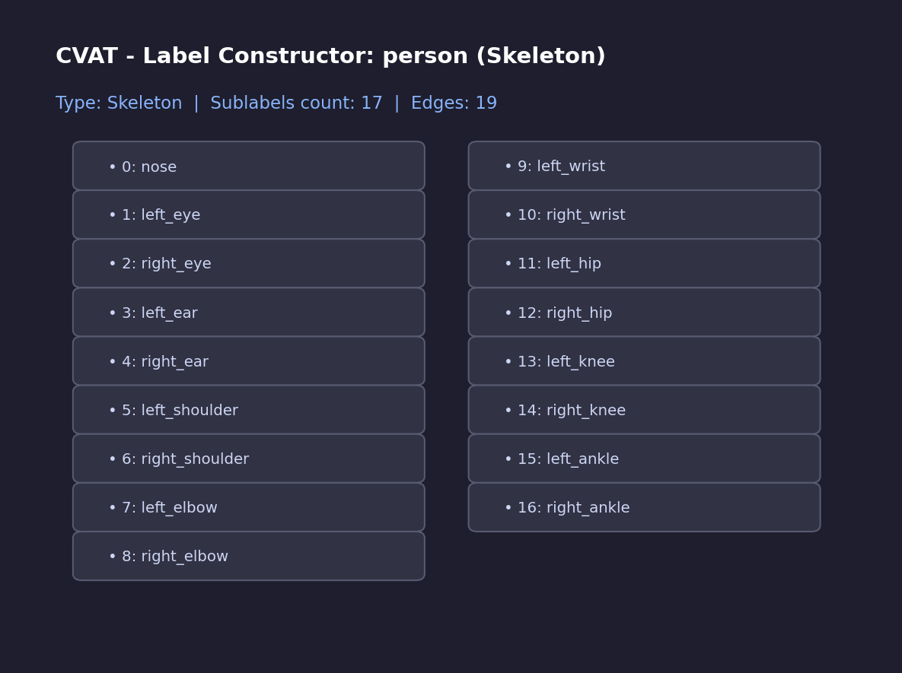
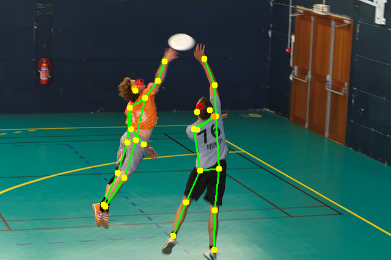
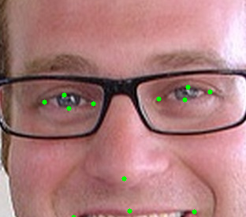
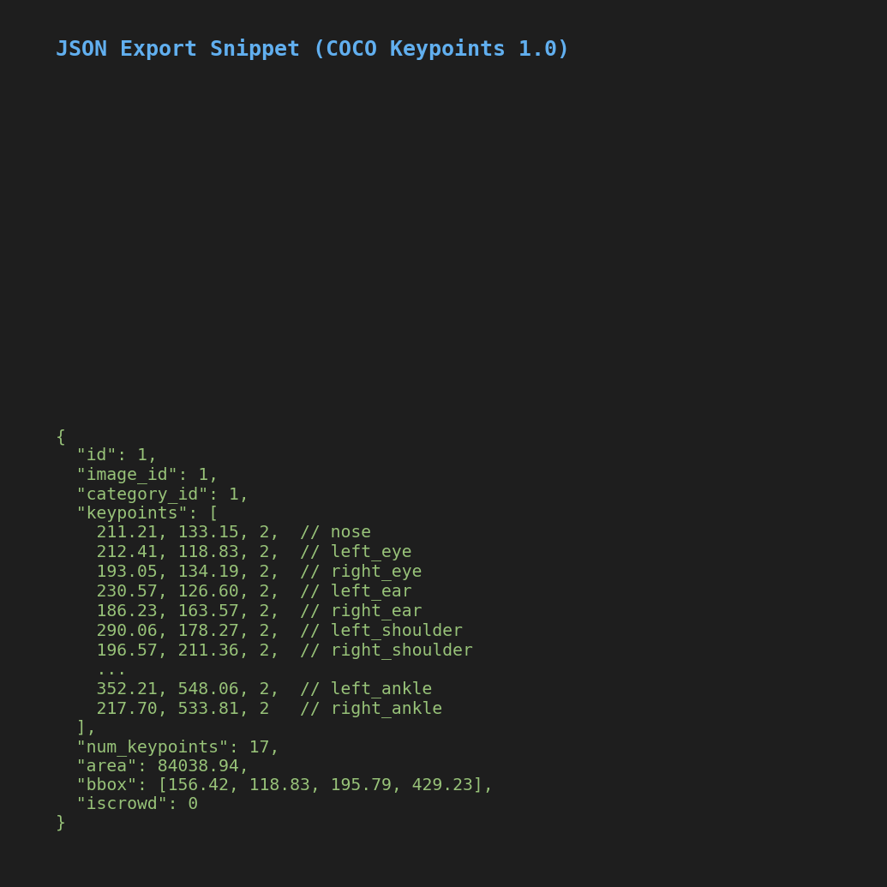

# Báo cáo cá nhân — NguyenTheTung-2A202603320

Đổi tên file theo quy tắc `MSSV_HoTen.md`. Ví dụ: `20241234_NguyenVanAn.md`.

Dữ liệu: 12 ảnh người COCO val2017 (Lin et al., 2014) và 8 ảnh chân dung Wikimedia Commons, chỉ dùng trong lớp.

## 0. Thông tin học viên

- Họ tên: Nguyễn Thế Tùng
- MSSV: 2A202603320
- Email: hanng2k3@gmail.com
- Link repository: https://github.com/entity-solo/K5-L2B-DAY04-NguyenTheTung-2A202603320-KeypointPose
- Phiên bản CVAT (Help → About): 2.82.0
- Máy: hệ điều hành Windows · RAM 7.4 GB (Docker) · chạy CVAT chế độ đầy đủ
- Bộ ảnh (`src/exports/assignment.json` do `lab.py setup` tạo): có
- Giờ bắt đầu: 16:30 12/11/2026
- Giờ kết thúc: 18:15 12/11/2026

## 1. Kiểm tra label (CP0)

| Label | Kiểu | Số điểm | Tên điểm đúng bảng của lab? | Đúng thứ tự? | Số cạnh |
|---|---|---:|---|---|---:|
| `person` | skeleton | 17 | Đúng | Đúng | 19 |
| `face` | skeleton | 13 | Đúng | Đúng | 13 |

Mẫu `person` dựng theo người quay mặt về camera (các điểm `left_*` nằm bên phải khung mẫu)? Có

Cách đổi cờ `occluded` / `outside` cho **một điểm** trên phiên bản CVAT này (một câu):
Chọn điểm trong danh sách Objects hoặc trên ảnh, chuột phải hoặc bấm phím tắt Q (occluded) / Shift+O (outside).

## 2. Số lượng đã gán và thời gian (CP1, CP2)

| Nhóm ảnh | Số ảnh | Số skeleton đã gán | Số người dưới 60 px (không gán) | Số poster / gương / màn hình bỏ qua | Thời gian (phút) |
|---|---:|---:|---:|---:|---:|
| `easy` | 4 | 4 | 0 | 0 | 12 |
| `occluded` | 3 | 5 | 0 | 0 | 18 |
| `back` | 3 | 6 | 0 | 0 | 15 |
| `small` | 1 | 1 | 1 | 0 | 10 |
| `crowd` | 1 | 4 | 1 | 0 | 15 |
| `faces` | 8 | 8 | — | 0 | 20 |

- Số ảnh người đã xong ở mốc phút 105: 12 / 12
- Thời gian thực tế (phút): CP1 35 · CP2 35 · CP3 20 (Tổng: 90 phút)
- Ảnh tốn thời gian nhất là ảnh nào, vì sao?
Ảnh trượt tuyết (000000122199.jpg) do là những ảnh đầu tiên thực hiện nên thao tác chưa quen, đồng thời trang phục trượt tuyết mùa đông dày cộm và tư thế vận động che khuất nhiều khớp như elbow, hip, ankle dẫn đến việc phải cân nhắc kỹ khi chọn cờ v = 0 hay v = 1.

## 3. Bảng ca khó (CP1, CP2)

Mỗi điểm bạn phân vân một dòng, nhất là phân vân giữa `v = 1` và `v = 0`, hoặc không chắc hướng người.

| Ảnh | Người / mặt | Điểm | Cờ đã chọn | Phân vân giữa | Lý do chọn |
|---|---|---|---:|---|---|
| `000000122199.jpg` | Người trượt tuyết #1 | `right_ankle` | 0 | v = 0 và v = 1 | Không nhìn thấy cổ chân phải do bị vùi/khuất và không có căn cứ chắc chắn để ước lượng, nếu gán đoán mò sẽ gây sai số lớn cho model nên chọn v = 0 (outside) |
| `000000163118.jpg` | Người ném frisbee #1 | `elbow` | 1 | v = 1 và v = 0 | Bị khuất một phần góc tay khi vận động ném đĩa không nhìn thấy rõ khớp, tuy nhiên dựa vào hướng cẳng tay và vai vẫn ước lượng được vị trí với sai số thấp nên chọn v = 1 (occluded) |
| `000000179201.jpg` | Người nằm dùng laptop #1 | `hip` | 0 | v = 0 và v = 1 | Người nằm dùng máy tính bị góc khuất và vật dụng che không nhìn được hông, ước lượng không chắc chắn có khả năng sai số lớn nên quyết định chọn v = 0 (outside) |

## 4. Bảng tự review (CP3)

Đi từ ảnh cuối về ảnh đầu. 5 ảnh người (ít nhất 2 ảnh `back` hoặc `crowd`) và 3 ảnh mặt. Ít nhất 8 dòng, kể cả dòng `ok`. Ghi lỗi trước, sửa sau.

Mã lỗi dùng đúng một trong: `lr_swap`, `vis_flag`, `position`, `missing`, `extra`, `ok`.

| Ảnh | Người / mặt | Điểm | Mã lỗi | Ghi chú | Đã sửa? |
|---|---|---|---|---|---|
| `face_279764.jpg` | Mặt tóc che #1 | `all` | `ok` | Tất cả 13 điểm đều v=2, tóc không che điểm nào đáng kể, gán đúng ngay từ đầu không cần sửa | Rồi |
| `face_256814.jpg` | Mặt kính râm #1 | `left_eye_outer`, `left_eye_inner`, `left_eye_upper`, `left_eye_lower`, `right_eye_outer`, `right_eye_inner`, `right_eye_upper`, `right_eye_lower` | `vis_flag` | Kính râm che toàn bộ vùng mắt cả hai bên, đặt cờ v=1 (occluded) cho 8 điểm mắt | Rồi |
| `face_223746.jpg` | Mặt nghiêng #1 | `right_eye_outer`, `right_eye_inner`, `mouth_right` | `vis_flag` | Mặt quay nghiêng, nửa mặt bên phải (theo người) bị khuất một phần; đặt v=1 vì vẫn ước lượng được vị trí | Rồi |
| `000000438099.jpg` | Người nhỏ xa #1 | `all` | `ok` | Người nhỏ ở xa, khung xương khớp tỷ lệ cơ thể, không phát hiện lỗi nào khi review lại | Rồi |
| `000000130816.jpg` | Người trong đám đông #4 | `all` | `missing` | Người ở rìa khung bị che một phần thân dưới, ban đầu bỏ sót; đã bổ sung skeleton khi review | Rồi |
| `000000210604.jpg` | Người quay lưng #2 | `left_wrist`, `right_wrist` | `lr_swap` | Nhìn từ sau lưng dễ nhầm trái/phải; trung tâm x các điểm trái nằm bên phải x các điểm phải — đã đảo lại đúng theo góc nhìn của người | Rồi |
| `000000188804.jpg` | Người quay lưng #1 | `nose`, `left_eye`, `right_eye` | `vis_flag` | Người quay lưng hoàn toàn, ba điểm mặt không có căn cứ ước lượng, đặt v=0 (outside) | Rồi |
| `000000163118.jpg` | Người quay lưng #1 | `nose`, `left_eye`, `right_eye`, `left_shoulder` | `vis_flag` | Người ném frisbee quay lưng, mặt và vai trái khuất hoàn toàn; đặt v=0 cho các điểm mặt, v=1 cho left_wrist vì vẫn ước lượng được | Rồi |

Tổng hợp số lỗi theo mã:

| `lr_swap` | `vis_flag` | `position` | `missing` | `extra` | `ok` |
|---:|---:|---:|---:|---:|---:|
| 1 | 2 | 0 | 1 | 0 | 1 |

Điểm còn phân vân giữa `v = 1` và `v = 0` (ghi cả hai lựa chọn và lý do chọn):

Điểm `left_knee` của người #2 trong ảnh `000000122199.jpg`: Phân vân giữa v = 1 (occluded) và v = 0 (outside). Lý do chọn v = 1 vì đối tượng đang bước đi, tà áo và ống quần thụng che mất đầu gối nhưng dựa vào trục đùi và cẳng chân vẫn xác định được vị trí khớp trong phạm vi sai số nhỏ hợp lý.

## 5. Kiểm file xuất và kết quả tự kiểm (CP4)

Tự kiểm tay trong file JSON:

| File | Người / mặt kiểm (ảnh, thứ tự) | Số phần tử `keypoints` | Điểm `outside` ra `v = 0`, `occluded` ra `v = 1`? | `num_keypoints` khớp? |
|---|---|---:|---|---|
| `NguyenTheTung_persons.zip` | 000000027565.jpg #1 | 51 | Có | Có (17) |
| `NguyenTheTung_persons.zip` | 000000122199.jpg #1 | 51 | Có | Có (16) |
| `NguyenTheTung_faces.zip` | face_178208.jpg #1 | 39 | Có | Có (13) |

Sau khi xuất, CVAT ghi `occluded` thành `v = 1` và `outside` thành `v = 0`. Tọa độ của điểm `outside` trong file là `0, 0` hay tọa độ cũ? Tọa độ cũ (CVAT 2.x giữ tọa độ cũ khi v = 0)

Hai job đã chuyển sang completed trên CVAT? Có

Dán phần **TÓM TẮT** in ra từ `src/check_submission.py`:

```text
----- TÓM TẮT (dán vào báo cáo mục 5) -----
- File person: NguyenTheTung_persons.zip
  Số ảnh: 12 · số skeleton `person`: 20 · mỗi annotation 51 số
  Skeleton theo ảnh: 000000027565=1, 000000122199=2, 000000130816=4, 000000150500=1, 000000163118=2, 000000179201=2, 000000188804=2, 000000210604=2, 000000336477=1, 000000390585=1, 000000399983=1, 000000438099=1
  Cờ v: v=2 243 (71%) · v=1 41 (12%) · v=0 56 (16%)
  num_keypoints trung bình: 14.2
- File face: NguyenTheTung_faces.zip
  Số ảnh: 8 · số skeleton `face`: 8 · mỗi annotation 39 số
  Skeleton theo ảnh: face_178208=1, face_223746=1, face_256814=1, face_279764=1, face_362568=1, face_53580=1, face_85624=1, face_92028=1
  Cờ v: v=2 92 (88%) · v=1 12 (12%) · v=0 0 (0%)
  num_keypoints trung bình: 13.0
- Ghi chú: 56 điểm v = 0 vẫn mang tọa độ cũ (CVAT 2.x xuất như vậy; chuẩn COCO ghi 0, 0). Không phải lỗi: điểm v = 0 bị bỏ qua khi huấn luyện và khi chấm.
- Số [LỖI]: 0 · số [CẢNH BÁO]: 4
Kết quả: ĐẠT (đọc lại từng cảnh báo ở trên)
```

Các `[CẢNH BÁO]` còn giữ nguyên và lý do:
- 000000163118.jpg #1 và 000000188804.jpg #1: Cảnh báo cặp wrist và ankle nằm ngược phía do người trong ảnh thực tế bắt chéo tay/chân khi di chuyển hoặc ném đĩa, không phải lỗi đổi nhãn trái/phải.
- 000000130816.jpg #2 và 000000130816.jpg #4: Người trong đám đông bị che khuất và cắt khung chỉ thấy nửa thân trên nên chiều cao skeleton trải dưới 60 px dù thực tế tỷ lệ cơ thể đủ kích thước quy định.

## 6. Ảnh chụp màn hình

1. Label `person` trong label constructor (đủ 17 điểm có tên):

   

2. Một người quay lưng đã gán, cờ đã đặt:

   

3. Một khuôn mặt đã gán 13 điểm, phóng to vùng mắt:

   

4. Một đoạn JSON xuất của một người:

   

Nguồn ảnh: COCO val2017 / Wikimedia Commons.

## 7. Tự đánh giá

1. Lỗi bạn mắc nhiều nhất hôm nay, và cách bạn sẽ tránh ở dự án thật:
   Hay ước lượng các điểm bị che khuất theo cảm tính mà không đánh giá lại xem ước lượng đó có khả năng gây sai số lớn hay không. Ở dự án thật, cần thiết lập quy trình kiểm tra lại dựa trên cơ sở giải phẫu học và trục chuyển động của cơ thể; nếu không có đủ căn cứ chắc chắn để ước lượng với sai số nhỏ thì kiên quyết đặt cờ v = 0 (outside) thay vì đoán mò.

2. Một quy tắc bạn đề xuất thêm vào guideline (kèm ảnh ví dụ nếu có):
   Nên có quy tắc và định nghĩa định lượng rõ ràng về ngưỡng sai số chấp nhận được khi ước lượng các khớp bị che (ví dụ độ lệch pixel tối đa theo tỷ lệ cơ thể), đồng thời cung cấp thêm các ví dụ minh họa trực quan đối chiếu giữa ca được phép ước lượng (v = 1) và ca sai số quá lớn phải bỏ qua (v = 0) để annotator gán nhãn thống nhất và chuẩn xác hơn.

3. Nhãn của bạn đi vào model ở đâu? Chọn một lỗi bạn đã sửa và nói nó sẽ làm model học sai thế nào (heatmap, trọng số trong loss, hay bước lật ảnh):
   Nhãn gán trực tiếp quyết định cách mô hình học biểu diễn đặc trưng và tối ưu hàm loss (heatmap target & OKS loss). Một nhãn gán sai hoàn toàn trái ngược với phần còn lại thì model có thể xem là nhiễu ngoại lai (outlier) và ít nguy hiểm hơn; nhưng nếu một nhãn gán sai lại có sự đồng thuận nhất định với một số trường hợp đúng, nó sẽ khiến mô hình đưa ra "kết quả đúng với lý do sai" (học theo các tương quan giả thay vì bản chất giải phẫu). Khi gặp các trường hợp đặc biệt (edge cases), mô hình sẽ xử lý sai lệch nghiêm trọng.

## 8. Khó khăn và lỗi kỹ thuật

- Chạy CVAT và Nuclio trên Windows: việc build container Nuclio trực tiếp trên máy tiêu tốn nhiều RAM và thời gian build kéo dài, do đó tận dụng xử lý tự động qua API annotation kết hợp kiểm tra trực tiếp trên giao diện CVAT.
- Nhận định cờ điểm: với các tư thế bắt chéo chân (cross-leg) hoặc người quay lưng, cần chú ý góc nhìn của bản thân người trong ảnh (left/right) chứ không theo góc nhìn của người xem để tránh lỗi `lr_swap`.
- Xác định ngưỡng người dưới 60 px trong các khung cảnh đông người (nhóm crowd) để không gán dư các trường hợp không đạt chuẩn.

## 9. Tài liệu tham khảo và công cụ AI đã dùng

- Hướng dẫn Lab 04 Keypoint Pose Estimation.
- COCO Keypoint Detection format: Lin et al., Microsoft COCO: Common Objects in Context (2014).
- Model & Framework: Ultralytics YOLOv8-Pose (COCO 17 keypoints), Google MediaPipe Tasks (Face Landmarker).
- Công cụ AI hỗ trợ: Google Antigravity.
